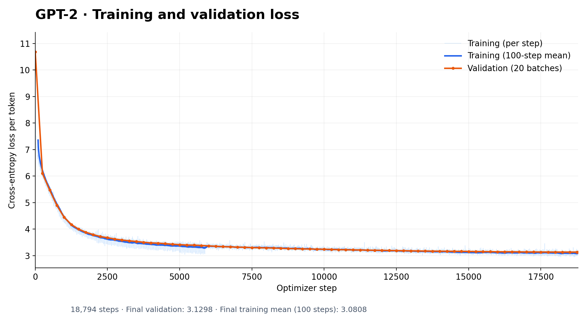

## GPT2 implementation from scratch

This is my implementation of GPT-2 from scratch with PyTorch, for learning purposes, following Andrej Karpathy's GPT-2 walkthrough

### Currently implemented:

- GPT2 architecture
    - Learned token and positional embeddings
    - Causal multi-head self-attention
    - Pre-LN blocks with residual connections and GELU MLPs
    - Final layer normalization and vocabulary projection
    - Weight tying between token embeddings and the output projection
    - GPT-2 weight initialization with smaller residual output projections

- Faster training with TF32, bfloat16 and torch.compile
- Gradient accumulation
- Validation every 250 steps and checkpoints every 5,000 steps, plus the last step
- HellaSwag evaluation at the end of training

### Training

I trained it on FineWeb-Edu for one epoch, about 9.85B tokens and 18,794 steps. The run took around 10 hours on a single RTX PRO 6000 Blackwell GPU.

Here is the training and validation loss:

The training curve is averaged over 100 steps to make it easier to read. Validation is measured on 20 batches each time.

- Final training loss: 3.0808 (average of the last 100 steps)
- Final validation loss: 3.1298

### HellaSwag

On the 10,042 examples in the validation split, I got:

- 29.51% accuracy with length normalization
- 28.61% without length normalization

This is consistent with the original GPT-2 124M result: about 29.55% with length normalization using [Karpathy's evaluation script](https://github.com/karpathy/build-nanogpt/blob/master/hellaswag.py).

### Remarks:

This is an implementation for learning purposes and is not meant to be optimized.
I use PyTorch's default GELU instead of GPT-2's tanh approximation, so the activation does not exactly match the original model.
